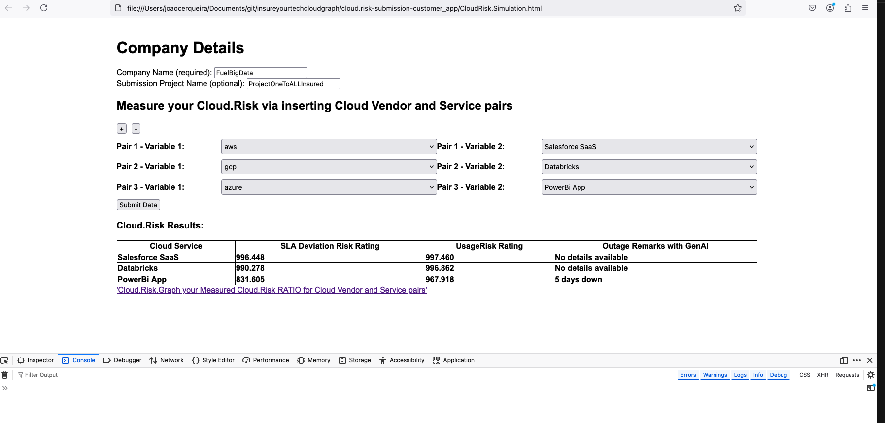
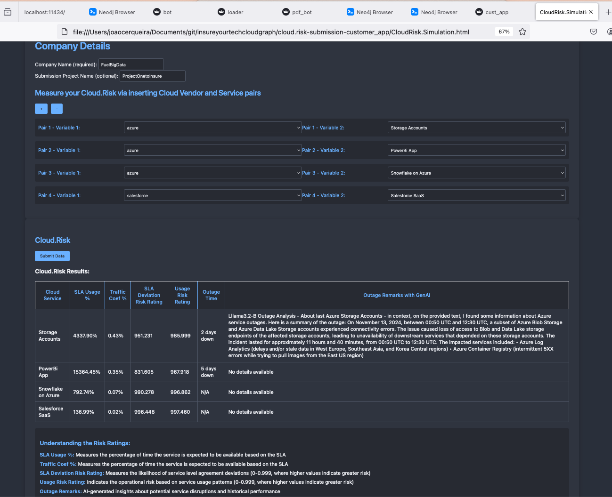
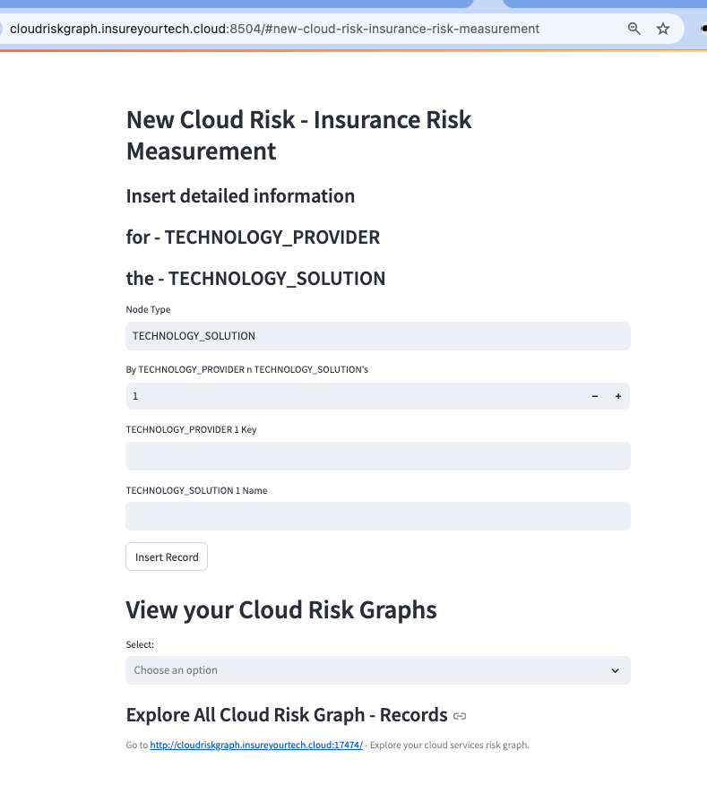
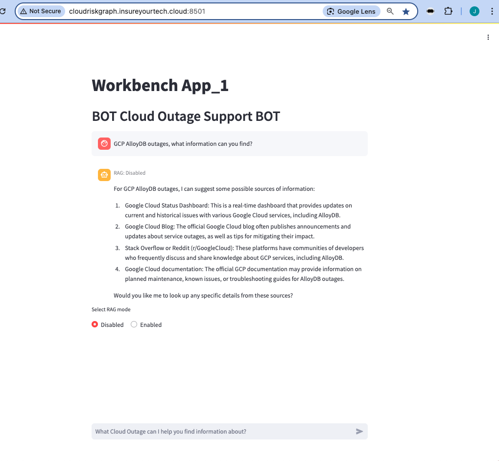
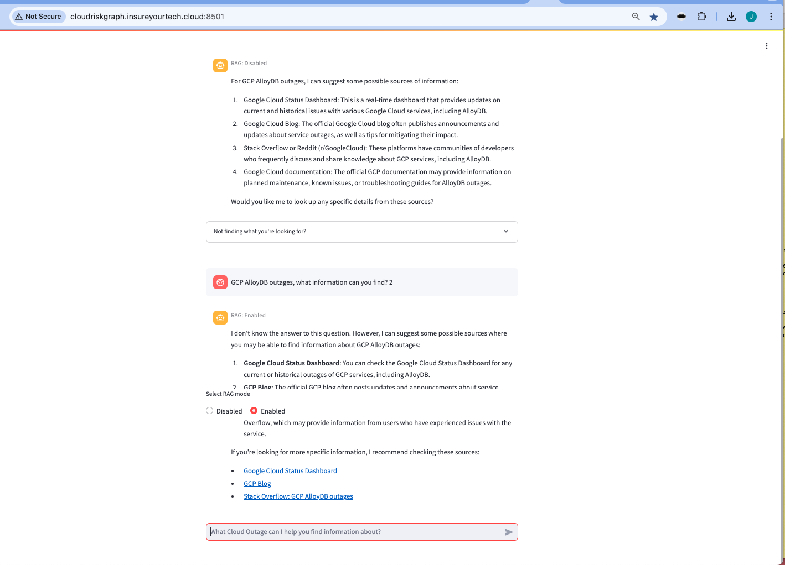
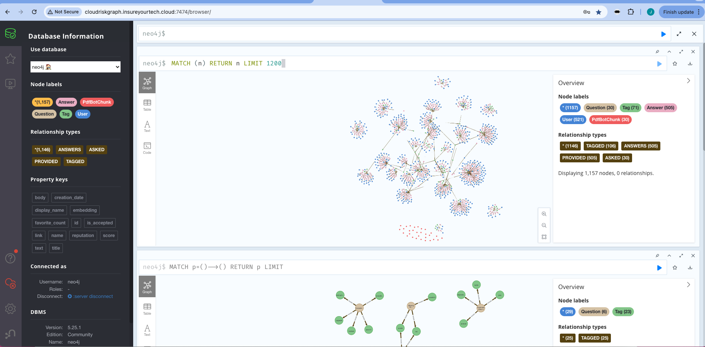

# InsureYourTech.Cloud 

## A Cloud Risk - Calculation engine

- - Insurance Risk Meajurement via graph analysis
- Customer Submission
  - Includes a customer Insurance Risk Meajurement App capable to calculate a cloud risk depending on requested technologies by a customer submission
  - For B2B and B2C usages - In Insurance Risk Meajurement
- Business Information - Workbench
  - Uses Public information  - a Graph approach to technology risks and outage information collection
  - Has Webscraping for automation information collection -  its is by Gen.AI stack , LLMs Vector(RAGs) of automatic info search 
  - - uses Ollama and Llama3.2 on prototype, custom model in construction


##  Customer Submission - via Submission Portal - Fremium example

Portal Fremium Submission: https://insureyourtech.cloud/cloudrisk-simulation

- Customer Submission Application
- Manually insert information about cloud usage to calculate your Cloud.Risk and SLA.Risk 
- 


- Customer Submission Application
- Manually insert information about cloud usage to calculate your Cloud.Risk and SLA.Risk 
- e.g. Azure Storage Accounts , with GenAI Outage information




##  Customer Submission - Insurance Risk Meajurement with Risk.Graph


UI: http://localhost:8504  

- Customer Submission Application
- New Cloud Risk - Insurance Risk Measurement
- Manually insert information about cloud usage to calculate your cloud risk graph
- 



## Customer - Cloud Risk Assesment App - B2C - Customer Cloud Risk Graph 


Client Risk Graph - New Cloud Risk Assesment : http://localhost:8504
Cloid Risk Measurement APP - Supported by Neo4J Risk.Graph

launch services

```
cd client_graph.risk_measurement_app
make all
bash -x open-all-applications
```


Customer B2C Sample Graph - overly simplified


 
### Cloud Information Workbench - GenAi supported collection about Cloud Risk Outages

```
cd cloud-information-genai-workbench
```

---

##  Workbench - App 1 bot  


UI: http://localhost:8501  

- Use Ollama LLm to search for Outages about cloud services
- In example search about AlloyDB outages in GCP cloud





---

##  Workbench - App 3 pdf-bot  


UI: http://localhost:8503  
DB client: http://localhost:7474

- import from PDF files Cloud services information
- Load high ranked cloud outages information
- Extract from PDF to Neo4J Vector information



	
