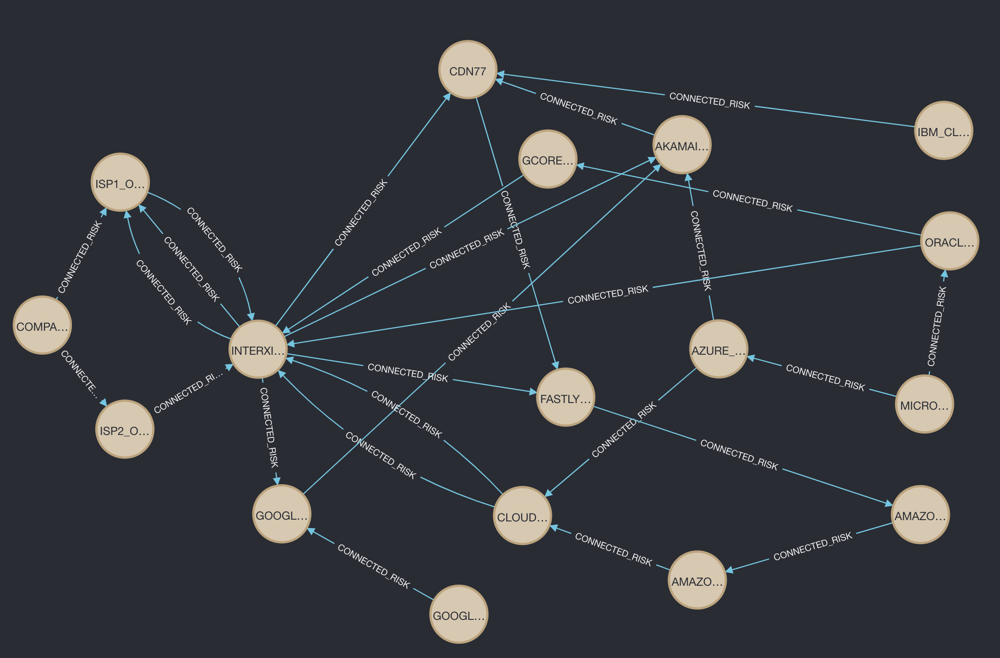

# insureyourtechcloudgraph
A graph approach to affinities technology risks

## Customer B2C Graph - Cloud risk 
Create with make

```
make riskgraph
```

Customer B2C Sample Graph - overly simplified


 
## Also includes our - GenAi information retrieval Demo - for Cloud Risk Outages

```
cd genai-information-retrieval-stack
```
