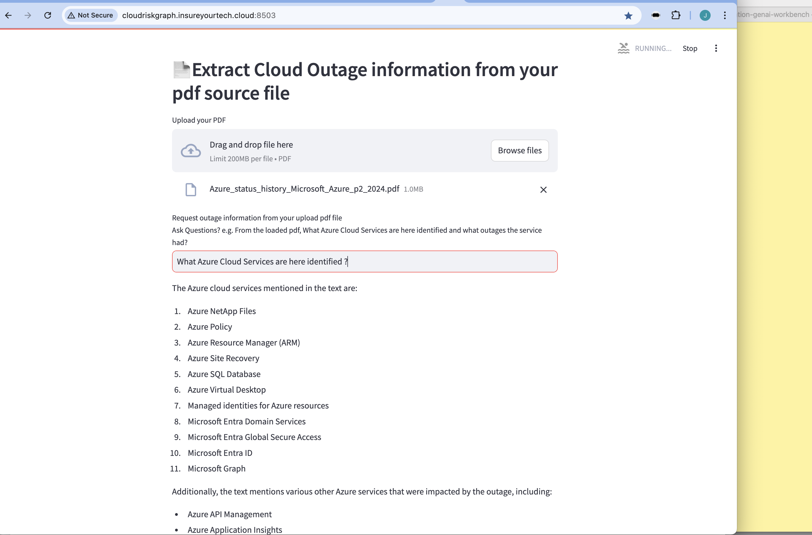

# insureyourtechcloudgraph
A Cloud Risk - Calculation engine for B2B amnd B2C usage
Public B2C graph in Neo4J - a Graph approach to technology risks and outages
Has Webscraping and automation supported by Gen.AI stack , LLMS, RAGs, Vectors of search , uses Ollama and Llama3.2 on prototype

## Customer B2C Graph - Cloud risk 
Create with make

```
make riskgraph
```

Customer B2C Sample Graph - overly simplified


 
### Cloud Information Workbench - GenAi supported collection about Cloud Risk Outages

```
cd cloud-information-genai-workbench
```

---

##  Workbench - App 3 pdf-bot  


UI: http://localhost:8503  
DB client: http://localhost:7474

- import from PDF files Cloud services information
- Load high ranked cloud outages information
- Extract from PDF to Neo4J Vector information



	
