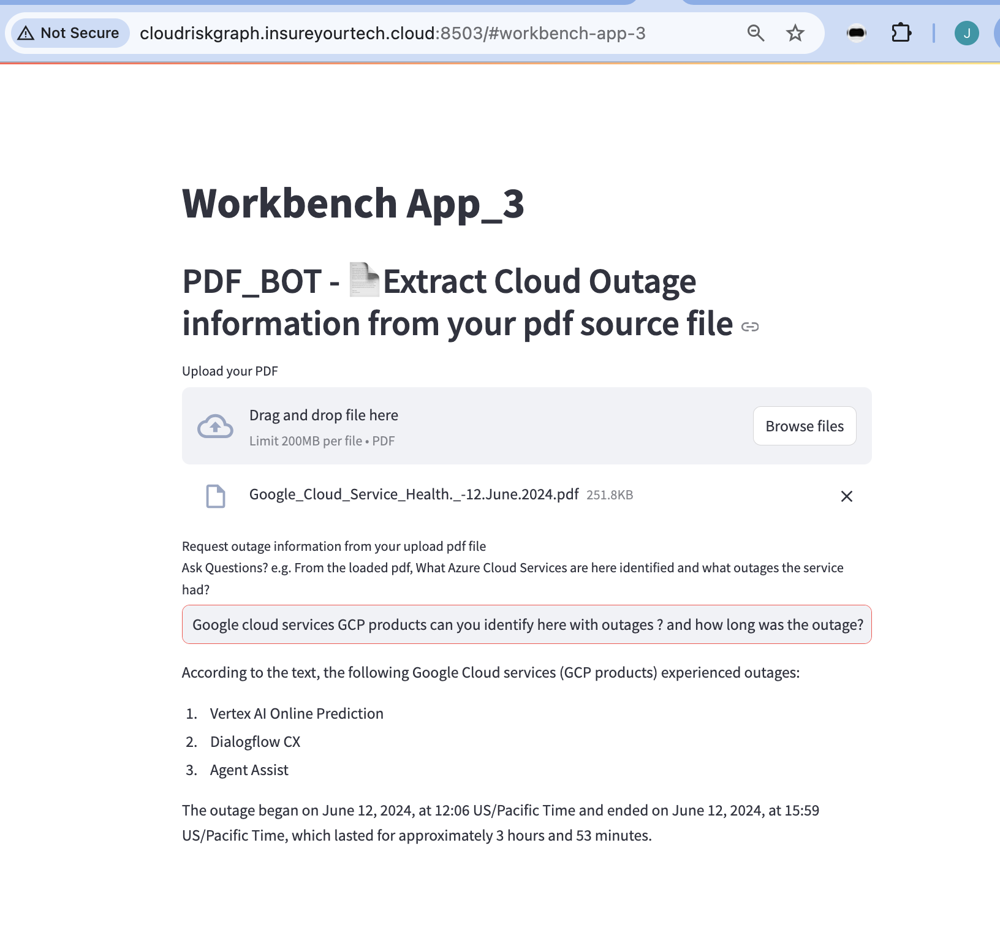
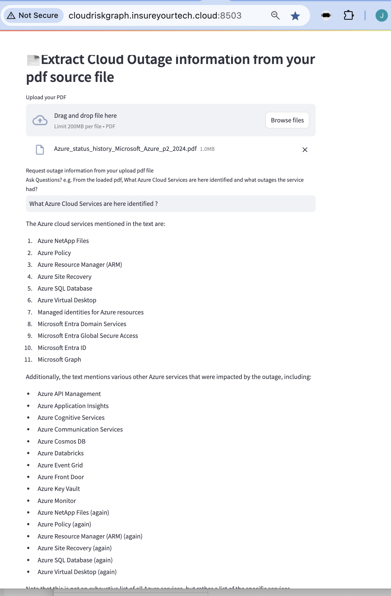
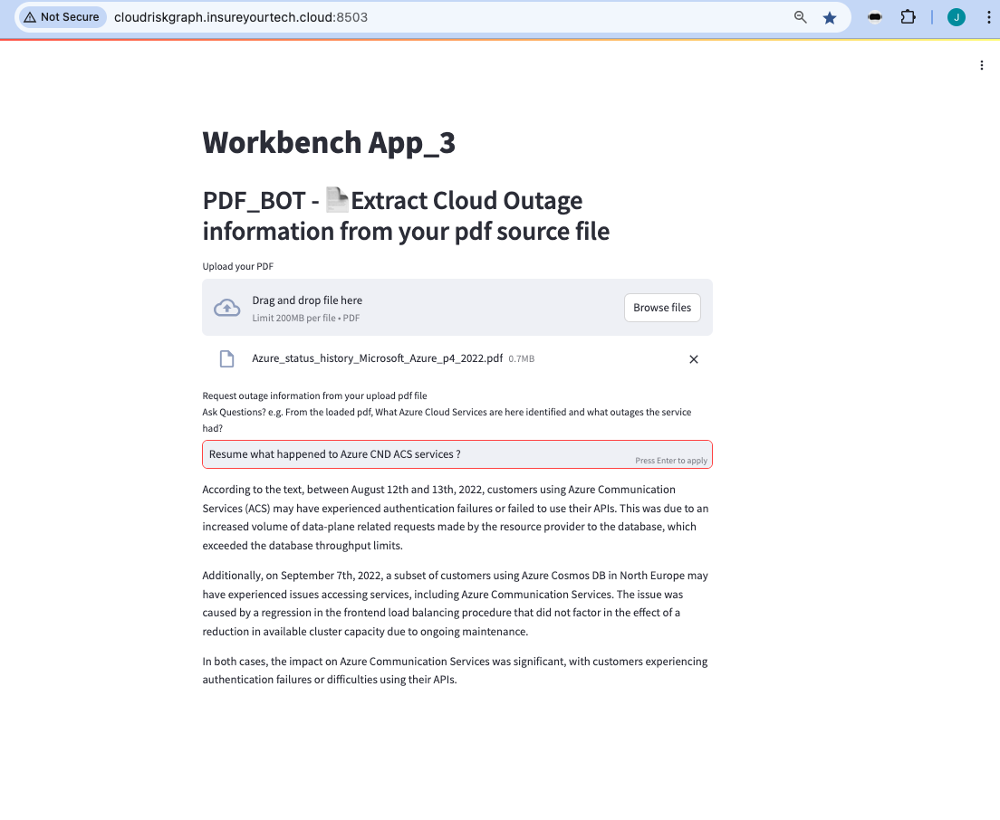
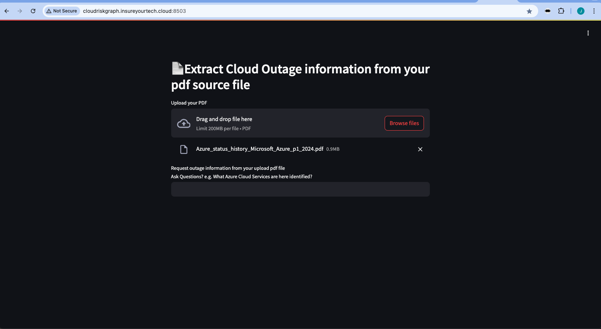
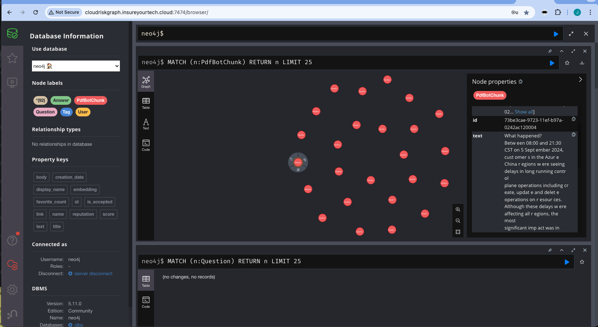
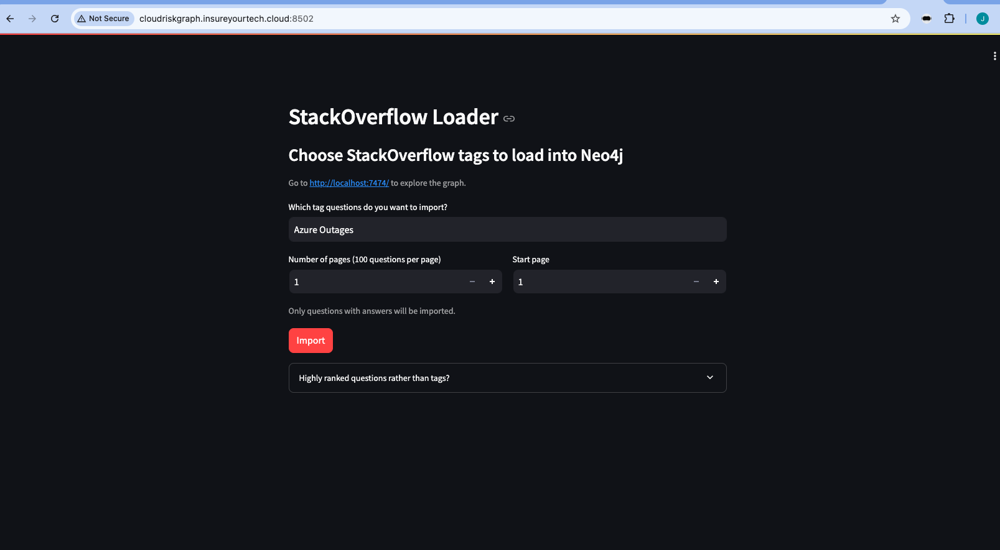
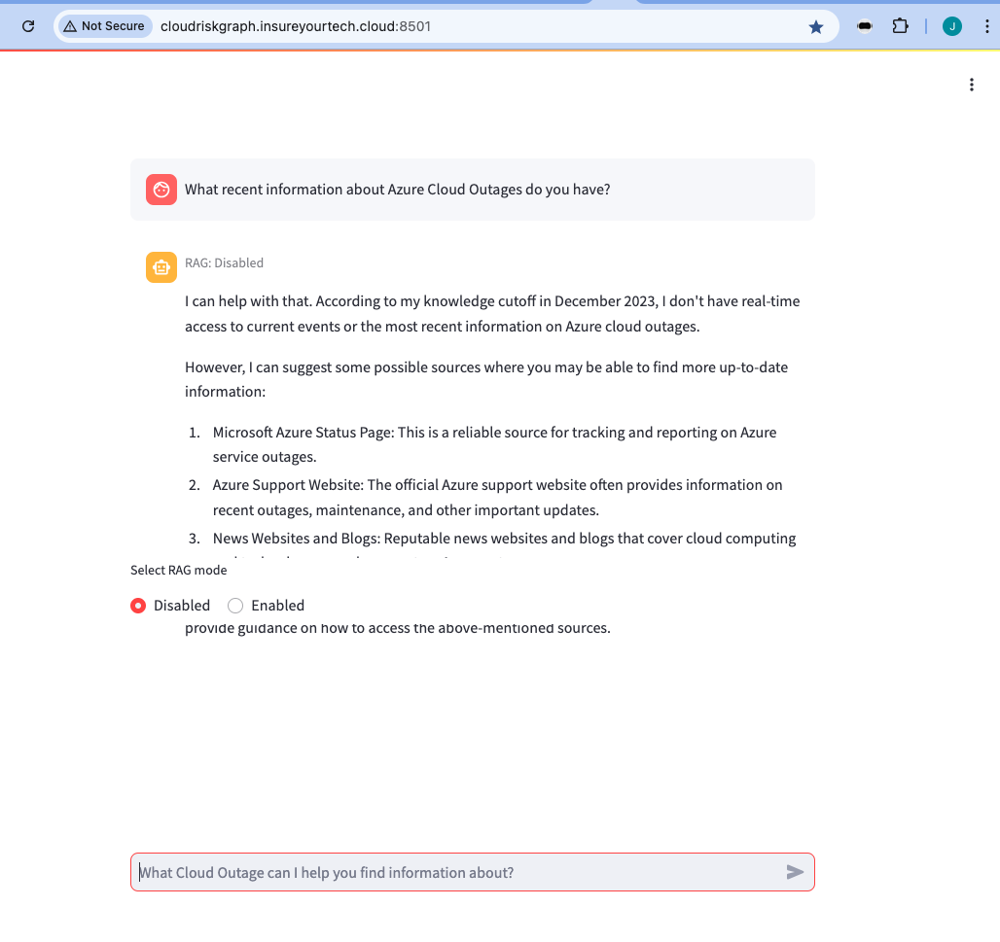
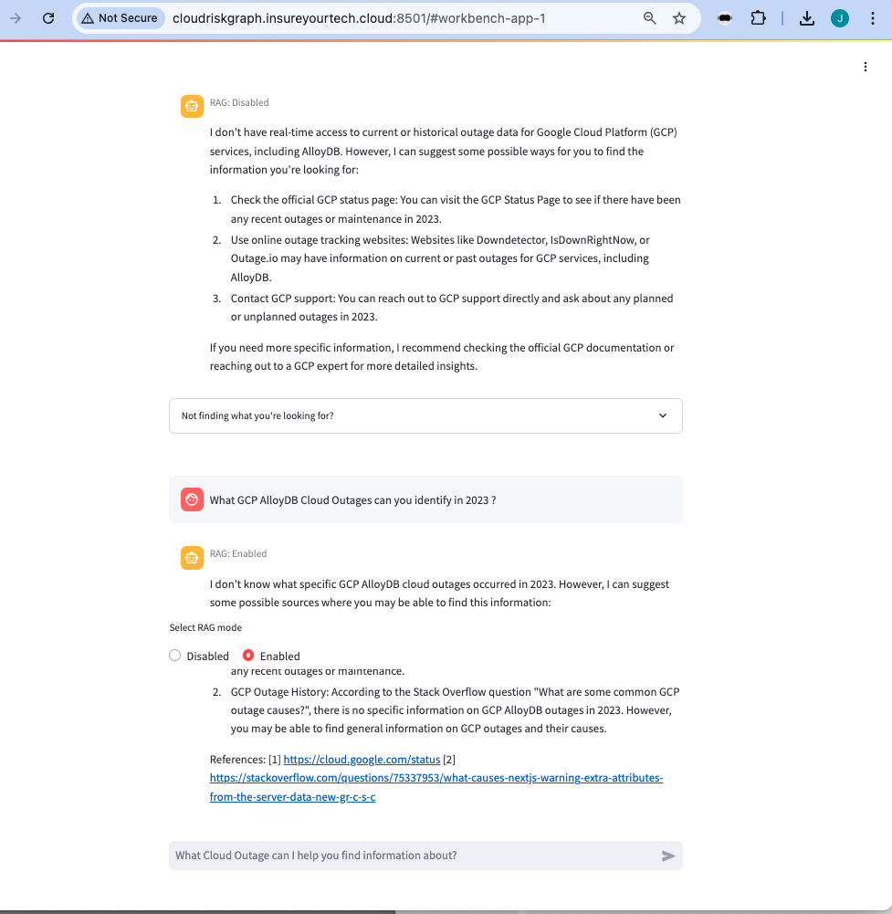

# Workbench Apps 
## Cloud information Extraction Supported by Gen.AI APPs
These 3 Apps allow us to information collection about cloud outages
Using our own GenAI application with support of Neo4J and LLM RAG we can accelerate information collection about Cloud service outages

# Configure

Create a `.env` file from the environment template file `env.example`

## LLM Configuration
MacOS and Linux users can use any LLM that's available via Ollama. Check the "tags" section under the model page you want to use on https://ollama.ai/library and write the tag for the value of the environment variable `LLM=` in th e`.env` file.  
All platforms can use GPT-3.5-turbo and GPT-4 (bring your own API keys for OpenAIs models).

**MacOS**  
Install [Ollama](https://ollama.ai) in MacOS and start it before running `docker compose up`.  

**Linux**  
No need to install Ollama manually, it will run in a container as 
part of the stack when running with the Linus profile: `run docker compose up --profile linux`.  

**Windows**  
Not supported by Ollama, so Windows users need to generate a OpenAI API key and configure the stack to use `gpt-3.5` or `gpt-4` in the `.env` file.

# Develop

**Lazy script starts everything**
```
bash -x workbench-start-cluster 1 
```

**To start everything**
```
docker compose up
```
If changes to build scripts has been made, **rebuild**
```
docker compose up --build
```

To enter **watch mode** (auto rebuild on file changes).  
First start everything, then in new terminal:
```
docker compose alpha watch
```

**Shutdown**  
Is health check fails or containers doesn't start up as expected, shutdown
completely to start up again.
```
docker compose down
```

# Applications

## Demo Workbench
### Cloud-Risk Applications with Gen.AI to
Obtain information about cloud services and outages
enrich core cloud risk engine with customer tailored information

---

##  Workbench - App 3 pdf-cloud_outage-bot  - External information Loader from pdf files 


UI: http://localhost:8503  
DB client: http://localhost:7474

- import from PDF files Cloud services information
- Load high ranked cloud outage information from documents (regardless of tags) to support the ticket generation feature of App 3.







--- 

##  workbench - App 2 - cloud_outage_loader - Information Loader

UI: http://localhost:8502  
DB client: http://localhost:7474

- import recent Search Engine data about Outages
- SO data for certain tags into a KG
- embed questions and answers and store in vector index
- UI: choose tags, run import, see progress, some stats of data in the database
- Load high ranked questions (regardless of tags) to support the ticket generation feature of App 1.


  


---

## Workbench - App 1 -  cloud_outage_bot - Support Agent

UI: http://localhost:8501  
DB client: http://localhost:7474

- answer support question based on recent entries
- provide summarized answers with sources
- demonstrate difference between 
    - RAG Disabled (pure LLM response)
    - RAG Enabled (vector + knowledge graph context)
- allow to generate a high quality support ticket for the current conversation based on the style of highly rated questions in the database.


  

*(Chat input + RAG mode selector)*


  
*(CTA to auto generate support ticket draft)*

  
*(UI of the auto generated support ticket draft)*
