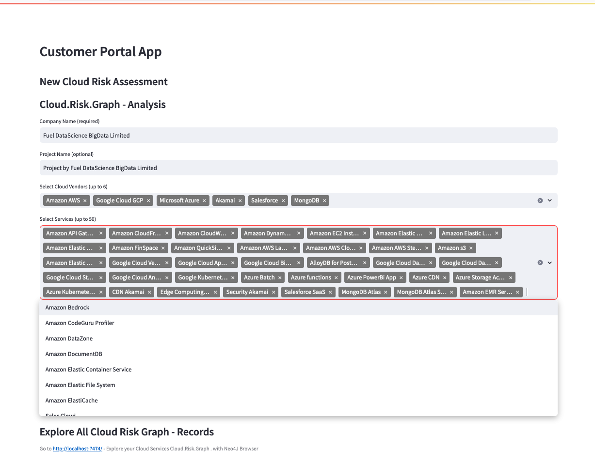
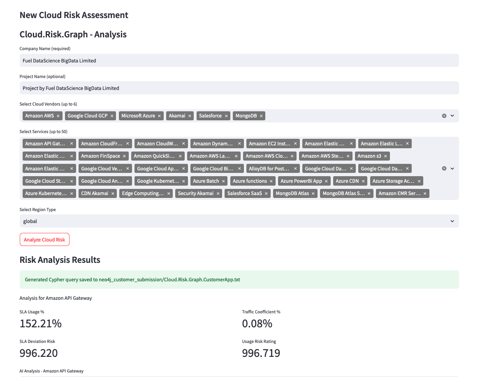
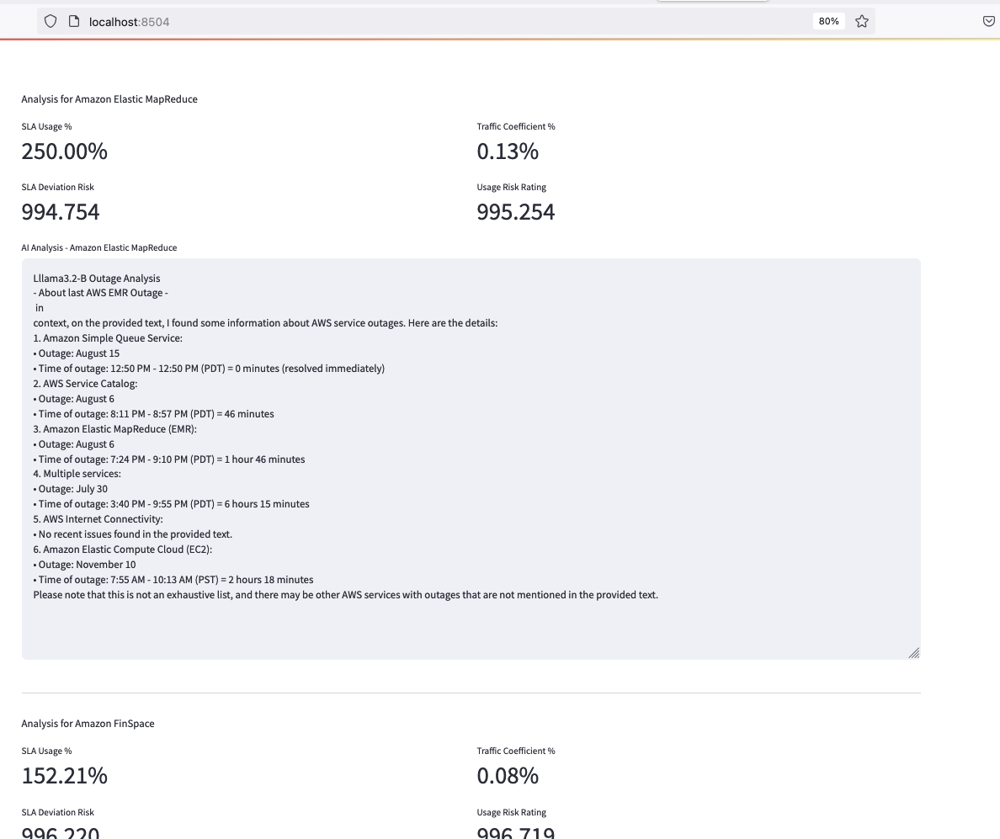
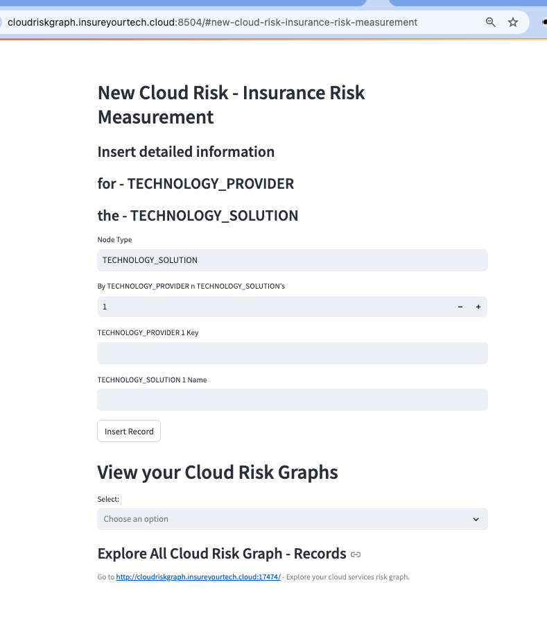

# Customer Application


**Lazy Customer App starts everything**
```
bash -x customer-app-start 1 
```

**To start it**
```
docker compose up
```
If changes to build scripts has been made, **rebuild**
```
docker compose up --build
```

---

##  Customer Submission - App 4  

UI: http://localhost:8504  

- Customer Portal - Submission Application
- New Cloud Risk - Insurance Risk Measurement
- Manually insert information about cloud usage to calculate your cloud risk graph
- 



-
- Obtain risk ratings for your cloud service usage - from your Cloud.Risk.Graph - 
