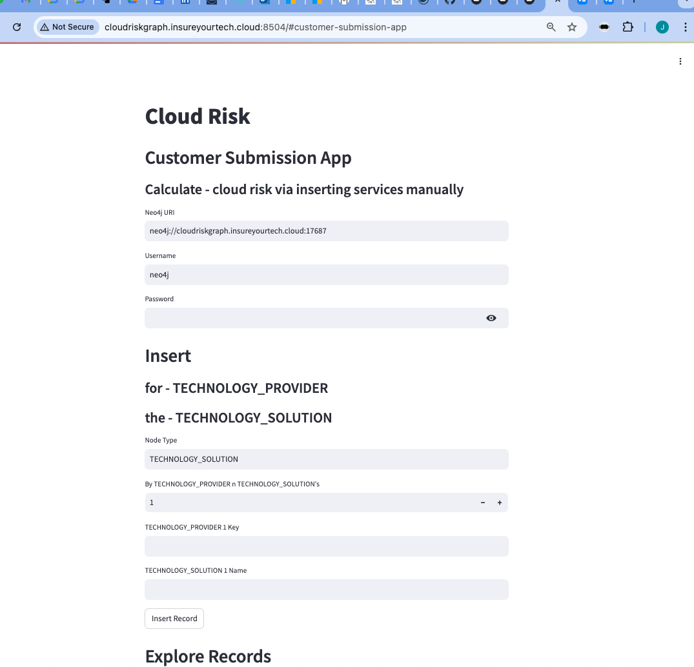

# Customer Application

**To start it**
```
docker compose up
```
If changes to build scripts has been made, **rebuild**
```
docker compose up --build
```

---

##  Customer Submission - App 4  

UI: http://localhost:8504  

- Customer Submission Application 
- Manually insert information about cloud usage to calculate your cloud risk graph
- 

