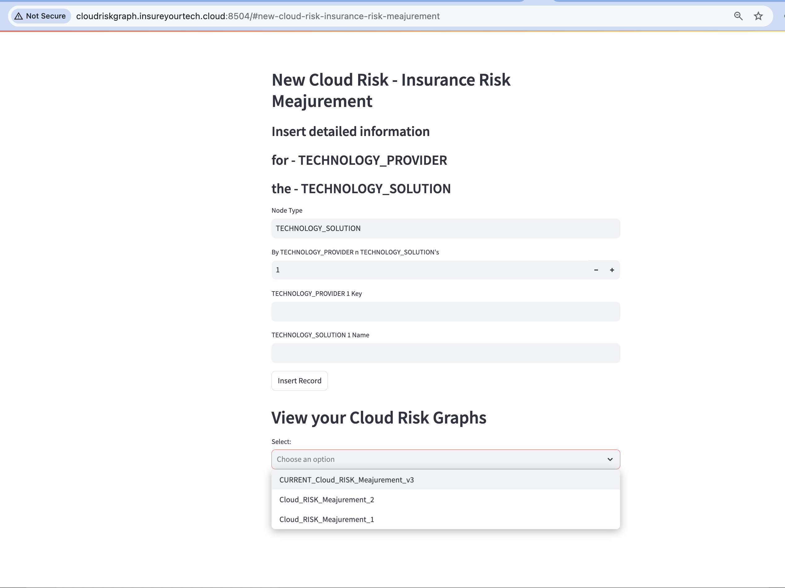

# Customer Application


**Lazy Customer App starts everything**
```
bash -x customer-app-start 1 
```

**To start it**
```
docker compose up
```
If changes to build scripts has been made, **rebuild**
```
docker compose up --build
```

---

##  Customer Submission - App 4  

UI: http://localhost:8504  

- Customer Submission Application
- New Cloud Risk - Insurance Risk Meajurement
- Manually insert information about cloud usage to calculate your cloud risk graph
- 

